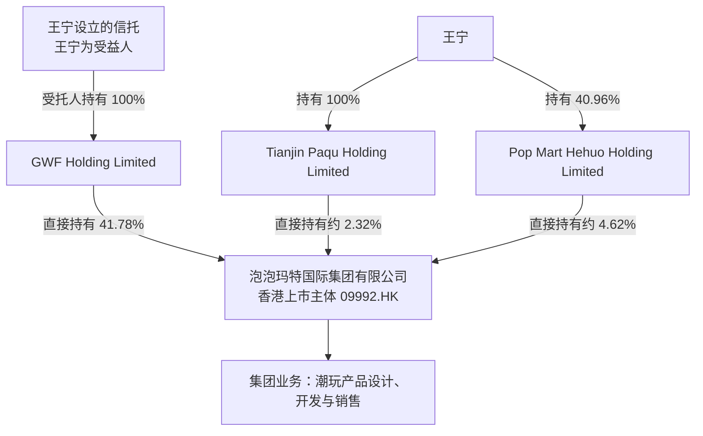

# 泡泡玛特示例：股权结构与管理层

> 教学示例。股权数据截至 **2025 年 12 月 31 日**，管理层与回购事实截至 **2026 年 6 月 30 日**。两者时点不同；图中比例不能代表 2026 年持股情况。本页不是完整治理尽调或投资建议。

## 一句话判断

泡泡玛特创始人与上市公司有明显的利益联系，且王宁同时担任董事长和 CEO。这样的结构可能有利于战略连续性，也使重大决策相对集中；仅凭结构本身，不能判断管理层诚信或公司治理好坏。要进一步看管理层如何使用股东资本，以及实际结果。

## 股权结构图

**如何读图：** GWF 持股 41.78%是公司年报披露的比例。Tianjin Paqu 和 Pop Mart Hehuo 的比例分别由年报披露的 31,196,420 股、62,053,027 股除以 2025 年末已发行的 1,342,943,150 股计算，约为 2.32% 和 4.62%。这两项是**相应持股实体的直接持股比例**，不是王宁分别持有上市公司的经济权益比例，也不能将三项直接持股简单相加当作他的个人经济权益。

信托与公司的关系按照年报披露呈现：UBS Trustees 作为信托受托人全资持有 GWF；年报同时说明王宁在证券权益披露口径下被视为拥有 GWF 持有的公司股份权益。图中“集团业务”用于说明上市主体的业务范围，**不是一家公司名称或具体持股比例**。其他股东及集团内部子公司未逐一展示。

来源：[2025 年报，报告第 55—58 页及财务报表附注](https://www1.hkexnews.hk/listedco/listconews/sehk/2026/0421/2026042100394.pdf)。

## 管理层：事实与判断分开

- **事实**：2026 年上半年，王宁同时担任董事长和 CEO。董事会在公告中表示，这种安排有利于领导和战略规划的一致性，并说明其对权力制衡的看法。[来源：2026 年中期业绩公告，第 42 页](https://www1.hkexnews.hk/listedco/listconews/sehk/2026/0820/2026082000353.pdf)
- **分析**：创始人集中决策可能加快战略执行，也可能使纠错更依赖董事会与团队的实际作用。董事会的说明是公司自己的判断；是否有效，仍要看具体决策、监督和结果。
- **尚不清楚**：仅凭本页资料，无法充分评价管理层长期诚信、团队接班能力或董事会在重大争议中的独立作用。需要继续查看历史承诺、实际经营结果及重大事项记录。

## 资本配置：回购说明什么

2026 年上半年，公司回购 1,122 万股，支付约 17.44 亿港元，回购股份随后被注销。[来源：2026 年中期业绩公告，第 43 页](https://www1.hkexnews.hk/listedco/listconews/sehk/2026/0820/2026082000353.pdf)

注销减少了流通股数，但**回购并不自动意味着为股东创造了价值**。判断还需要研究当时支付的价格与公司价值的关系、资金是否来自可持续现金流，以及公司是否因此牺牲必要投资。本例未完成独立估值，因此不对回购价格是否划算下结论。

## 下一步研究

1. 查看更新的股东披露与股份变动，重新绘制对应日期的股权结构。
2. 比较管理层过去的经营承诺、资本投入与实际结果。
3. 核对重大关联交易、薪酬激励和董事会对关键事项的具体监督记录。
4. 若要评价回购，先完成独立估值，并分析现金流和其他资金用途。
